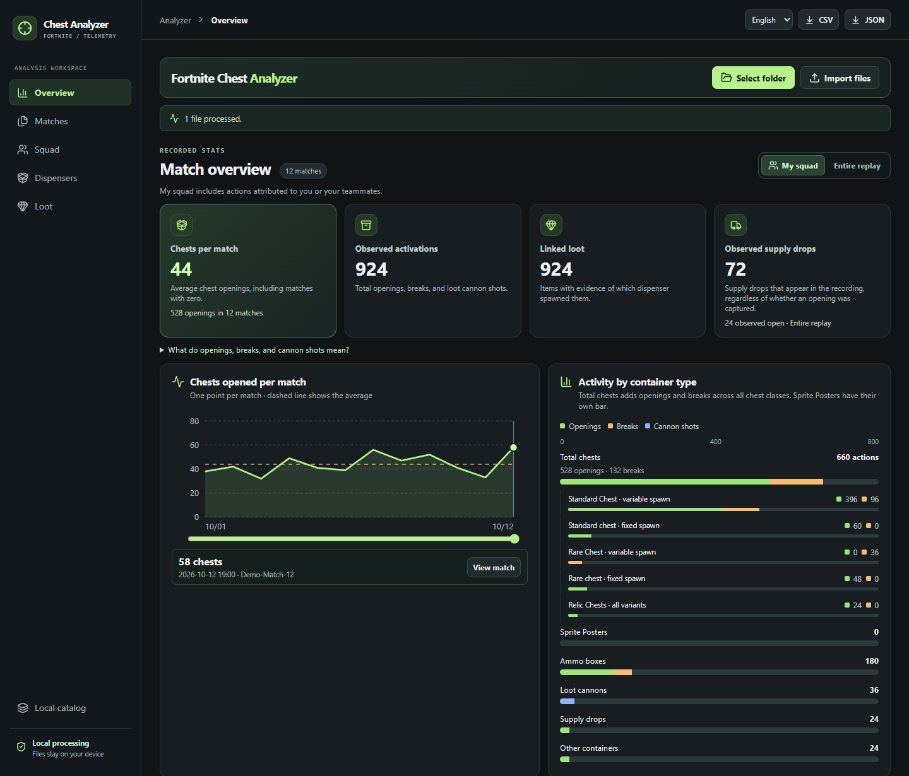

# Fortnite Chest Analyzer

**Un panel local para analizar cofres, botín y actividad de escuadrón en repeticiones de Fortnite.**

[](https://github.com/saturnus25/Fortnite-Chest-Analyzer/releases/latest)
[](https://github.com/saturnus25/Fortnite-Chest-Analyzer/releases/latest)
[](LICENSE)
[](README.md)

[Descargar para Windows](https://github.com/saturnus25/Fortnite-Chest-Analyzer/releases/latest) · [Cómo funciona](#cómo-funciona) · [English](README.md) · [Informar de un problema](https://github.com/saturnus25/Fortnite-Chest-Analyzer/issues)

> [!NOTE]
> **Desarrollo asistido por IA.** OpenAI Codex ayudó a implementar, traducir y documentar el proyecto. El lector se comprobó con un lote privado de 100 repeticiones de Fortnite 43.00. Se analizaron 99 y una quedó marcada como incompatible. La captura usa datos sintéticos. El proyecto es independiente de Epic Games.



## Qué puedes consultar

| Cofres y dispensadores | Actividad del escuadrón |
| :--- | :--- |
| Separa aperturas, rupturas y disparos de cañón. Compara cofres por partida, consulta la clase interna de cada contenedor y distingue las entregas observadas de sus aperturas. | Cambia entre tu escuadrón y todo lo que captó la repetición. Ordena las estadísticas por cualquier columna numérica y consulta los nombres de Epic registrados para cada cuenta. |
| **Botín y artilugios** | **Trabajo local** |
| Consulta botín vinculado, orígenes sin resolver, consumibles de extracción y actores de artilugio identificados. El informe conserva por separado el estado de recogida y la evidencia del origen. | Importa carpetas, archivos `.replay` o ZIP. Exporta y vuelve a abrir JSON y CSV. Cambia entre español e inglés con el análisis abierto. |

## Empezar

1. Descarga el **ZIP para Windows x64** desde la [última release](https://github.com/saturnus25/Fortnite-Chest-Analyzer/releases/latest).
2. Extrae el archivo y abre **Abrir analizador.exe** dentro de la carpeta `Fortnite-Chest-Analyzer-v…`. Cada release tiene su propia carpeta. Para volver a extraer la misma versión, elige otro destino.
3. Mantén la ventana del lanzador abierta mientras usas la web. El paquete incluye el entorno de ejecución y funciona sin instalar Rust, Node.js ni .NET. Al terminar, pulsa **Cerrar servidores locales**, confirma y cierra la pestaña cuando aparezca el aviso.
4. Selecciona tu carpeta de repeticiones o importa archivos. El selector recorre las subcarpetas. Si tienes un RAR, extrae primero su contenido.
5. Usa **Idioma**, junto a los botones CSV y JSON, para elegir **Español** o **English**. El navegador recuerda la elección.

## Cómo funciona

React y TypeScript muestran el dashboard. El lector Rust se compila a WebAssembly y reparte las repeticiones entre hasta cuatro Web Workers. Para otros protocolos, la web intenta usar el lector anterior de .NET WebAssembly. El lanzador de Windows sirve los archivos estáticos en la interfaz local. Las repeticiones y los informes importados permanecen en el dispositivo.

**Formato validado.** Fortnite `43.00`, contenedor `7`, cabecera de red `19` y protocolo de motor `45`. Otras versiones pueden devolver resultados parciales o incompatibles. La repetición local solo recoge la actividad replicada al cliente que grabó. La aparición de un actor de artilugio deja sin determinar su uso y obtención. **Pirate Shop Access.** El panel compara la plantilla de premio del cofre con el ID exacto `DelilahPrize:PirateAccount`. Se descodificaron otros dos premios en repeticiones reales. La coincidencia del token se probó con datos sintéticos y queda pendiente validarla con una repetición real que lo contenga. Consulta las [notas de formato y validación](INVESTIGACION.md) para conocer los criterios de evidencia, la cobertura y las fuentes.

### Cómo leer el dashboard

- **Actividad por tipo de contenedor** cuenta las acciones registradas en el alcance seleccionado. El total incluye cofres normales, raros, de reliquias y enterrados. La gráfica distingue apariciones fijas y variables, así como aperturas y rupturas. La recogida de pósteres de espíritu tiene su propia fila.
- **Contenedores por clase** cubre todo el replay. **Vistos abiertos** cuenta los contenedores registrados en estado abierto. La tabla reparte el total entre tu escuadrón, otros equipos identificados y casos sin equipo identificado. Los cofres de aparición fija llevan un borde amarillo. Si un informe antiguo carece del desglose, vuelve a analizar el replay original.
- **Premios de artilugios** muestra los registros de toda la grabación y los premios observados de tu escuadrón. Tres registros del mismo premio en una sola apertura de tu equipo cuentan como un premio del escuadrón. Dos aperturas distintas cuentan como dos. **No determinado** indica que la repetición o el informe no aportan pruebas suficientes para calcular la cifra.

**Catálogo local.** Admite una carpeta con imágenes de objetos y un `catalogo.json`, `catalog.json` o `items.json` opcional. Indica el `id` exacto y, cuando estén disponibles, `name`, `rarity`, `icon` o `branch`. Un token pirata verificado se puede marcar con `"special": "pirate-token"` y la rama correspondiente. Los datos aportados por el usuario y los identificadores del juego se conservan al cambiar de idioma.

## Compilar desde el código fuente

Usa Node.js 24, el SDK .NET 10 y Rust estable. El código de la interfaz, ambos lectores y el lanzador está en [src](src/), [engine-rust](engine-rust/), [parser](parser/) y [launcher](launcher/).

```sh
rustup target add wasm32-unknown-unknown
npm ci
npm run build
npm run preview -- --port 5182
```

En Windows, ejecuta `pwsh -File scripts/build-portable.ps1` después de compilar para crear el ZIP portable. Para servir la web como sitio estático, publica `dist/` mediante HTTPS.

Ejecuta `cargo test --manifest-path engine-rust/Cargo.toml` para las pruebas de Rust. La [prueba de navegador](tests/browser.mjs) utiliza repeticiones locales. Configura `REPLAY_SAMPLES` con su carpeta, `REPLAY_URL` con la dirección de la web si hace falta y `REPLAY_BROWSER` con el ejecutable de Edge o Chromium. La regresión completa usa el lote privado de validación.

## Licencia

El proyecto usa **GNU GPL v3 o posterior**. La redistribución de versiones cubiertas mantiene las condiciones de la GPL, incluida la entrega del código fuente correspondiente. Los avisos de terceros se incluyen en [public/licenses](public/licenses/), [parser](parser/) y el paquete portable. [Leer la licencia](LICENSE).
