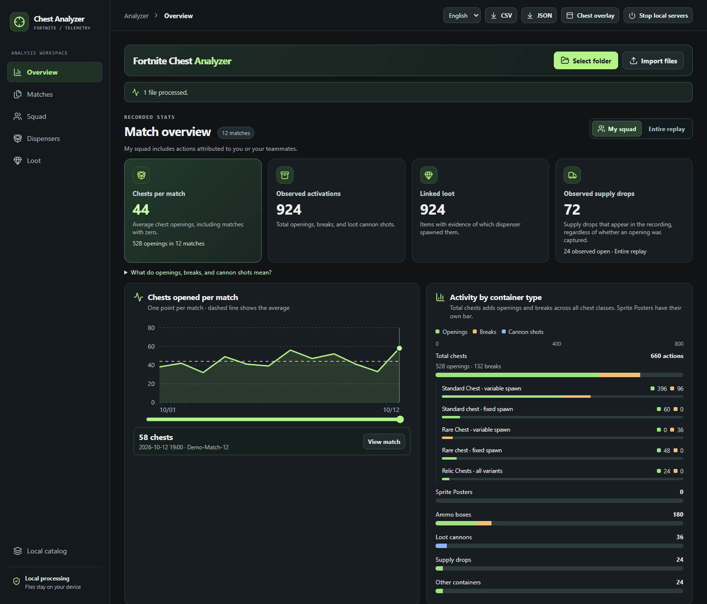
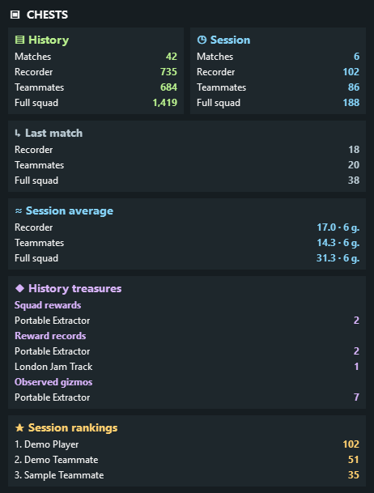

# Fortnite Chest Analyzer

**A local Fortnite replay dashboard and Windows overlay for chests, loot, and squad activity.**

[](https://github.com/saturnus25/Fortnite-Chest-Analyzer/releases/latest)
[](https://github.com/saturnus25/Fortnite-Chest-Analyzer/releases/latest)
[](LICENSE)
[](README.es.md)

[Download](https://github.com/saturnus25/Fortnite-Chest-Analyzer/releases/latest) · [Quick start](#quick-start) · [Overlay](#chest-overlay) · [Ideas](https://github.com/saturnus25/Fortnite-Chest-Analyzer/discussions/categories/ideas) · [Issues](https://github.com/saturnus25/Fortnite-Chest-Analyzer/issues) · [Español](README.es.md)

> [!NOTE]
> **AI-assisted development.** OpenAI Codex helped implement, translate, and document this project. The replay reader was checked against a private set of 100 Fortnite 43.00 recordings, with 99 analyzed and one marked unsupported. The preview below uses synthetic data. The project is independent of Epic Games.



## Quick start

1. Download the versioned **Windows x64 ZIP** from the [latest release](https://github.com/saturnus25/Fortnite-Chest-Analyzer/releases/latest).
2. Extract the archive. Open **Abrir analizador.exe** for the dashboard or **Abrir overlay.exe** for the standalone overlay.
3. Keep the launcher window open while using the dashboard. The package includes the runtime and needs no Rust, Node.js, or .NET installation. When finished, click **Stop local servers**, confirm, and close the browser tab when prompted.
4. Select your replay folder or import files. Folder imports include subfolders. Extract RAR archives first.
5. Use the **Language** selector next to the CSV and JSON buttons to choose **English** or **Español**. The browser remembers the choice.

## What you can see

| Chests and dispensers | Squad activity |
| :--- | :--- |
| Openings, breaks, and loot cannon shots are counted separately. Compare chests per match, view the internal container class, and distinguish observed supply drops from recorded openings. | Switch between your squad and everything captured by the replay. Sort player stats by any numeric column and browse the Epic display names recorded for each account. |
| **Loot and gizmos** | **Local workflow** |
| See linked loot, unresolved sources, extraction consumables, and identified gizmo wheel actors. The report keeps pickup status and source evidence separate. | Import folders, individual `.replay` files, or ZIP archives. Export and reimport JSON or CSV. English and Spanish can be switched without clearing the analysis. |

## How it works

React and TypeScript render the dashboard. A Rust reader compiled to WebAssembly processes recordings across up to four Web Workers. The legacy .NET WebAssembly reader provides a fallback for other replay protocols. The Windows launcher serves static files over loopback. Replays and imported reports stay on the device, and the analysis requires no account or upload.

**Validated format.** Fortnite `43.00`, replay container `7`, network header `19`, and engine protocol `45`. Later or older builds may yield partial or unsupported results. Local recordings only capture the actors and changes replicated to the recording client. A gizmo actor sighting does not establish who used it or when it was obtained. **Pirate Shop Access.** The reward panel checks the replicated chest prize for the exact template `DelilahPrize:PirateAccount`. Two different reward templates were decoded from real replays. The positive Pirate Shop case was tested with synthetic data and still needs a real recording containing the token. See the [format and validation notes](INVESTIGACION.md) for the evidence rules, coverage, and upstream sources.

## Chest overlay



Run **Abrir overlay.exe** to open the marker and its controls. Standalone mode runs the shared replay analyzer through Windows WebView2. The **Chest overlay** button in the dashboard also works while that tab remains open. In the controls, choose the replay folder, position the marker, and select the counters. You can minimize the controls while playing. The marker passes mouse input through and cannot take focus. Closing the controls closes the marker.

- **Session** covers matches completed since the overlay was opened. **History** covers all matches read while the overlay has been open, including replays that Fortnite has since removed from the folder.
- The overlay counts chest openings and attributed breaks. Chests seen destroyed without an identified team are shown separately when the replay provides that evidence. **Averages** uses the matches where each group could be identified. Choose recorder, teammates only, or the full squad independently. A dash means the count or average is undetermined.
- Toggle each section independently for session and history. **Treasures** distinguishes squad rewards, reward records across the replay, and observed gizmos. **Player rankings** shows the latest recorded Epic name for each verified account. Use **Ranking size** to choose 1–12 players.
- Drag **Marker size** to scale the whole marker. **Fixed width** and **Fixed height** set its dimensions at 100%. The cards adapt to the space available.

### Reading the dashboard

- **Container activity** counts recorded actions in the selected scope. The chest total includes standard, rare, relic, and buried chests. The chart separates fixed and variable spawns, and distinguishes openings from breaks. Sprite Poster pickups have their own row.
- **Containers by class** covers the whole replay. **Observed open** counts containers recorded in an open state. The table splits that total by your squad, other identified teams, and unknown team. Fixed spawns have a yellow outline. Reanalyze the original replay if an older report lacks this breakdown.
- **Gizmo rewards** counts recorded rewards across the replay and shows your squad's observed rewards separately. Three records of the same reward from a single opening for your squad count as one squad reward. Two separate openings count as two. **Undetermined** means the replay or report has insufficient evidence to establish the count.

**Local catalog.** The app accepts a folder with item images and optional `catalogo.json`, `catalog.json`, or `items.json`. Supply the exact `id` and optionally `name`, `rarity`, `icon`, or `branch`. A verified pirate token can be marked with `"special": "pirate-token"` and an exact `branch`. User-provided names and raw game IDs are preserved when switching languages.

## Build from source

Use Node.js 24, the .NET 10 SDK, and stable Rust. The source for the dashboard, both replay engines, and the Windows launcher is under [src](src/), [engine-rust](engine-rust/), [parser](parser/), and [launcher](launcher/).

```sh
rustup target add wasm32-unknown-unknown
npm ci
npm run build
npm run preview -- --port 5182
```

On Windows, run `pwsh -File scripts/build-portable.ps1` after the build to package the Windows x64 release. To host it as a static site, serve `dist/` over HTTPS.

Run `cargo test --manifest-path engine-rust/Cargo.toml` for the Rust tests. The [browser test](tests/browser.mjs) expects local replay fixtures. Set `REPLAY_SAMPLES` to a folder containing your files, `REPLAY_URL` to your running app if needed, and `REPLAY_BROWSER` to the Edge or Chromium executable. The full replay regression suite uses the private validation set.

## License

The project is licensed under **GNU GPL v3 or later**. Redistribution of covered versions remains subject to the GPL, including its corresponding-source requirements. Third-party notices are in [public/licenses](public/licenses/), [parser](parser/), and the portable package. [Read the license](LICENSE).
